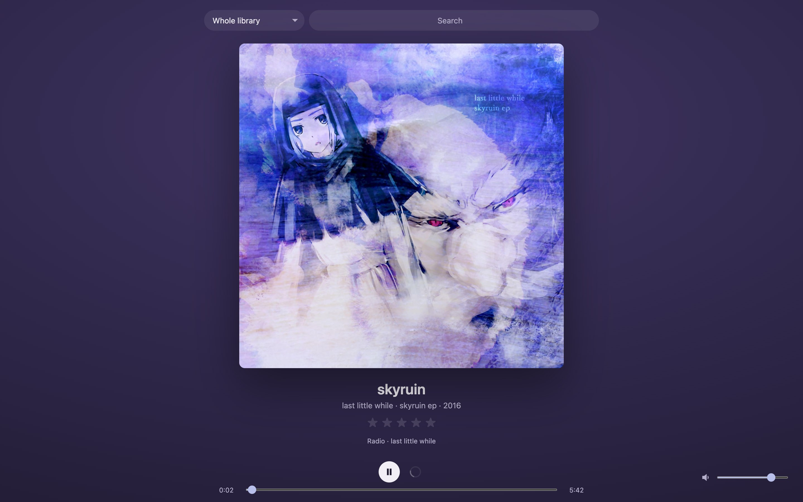
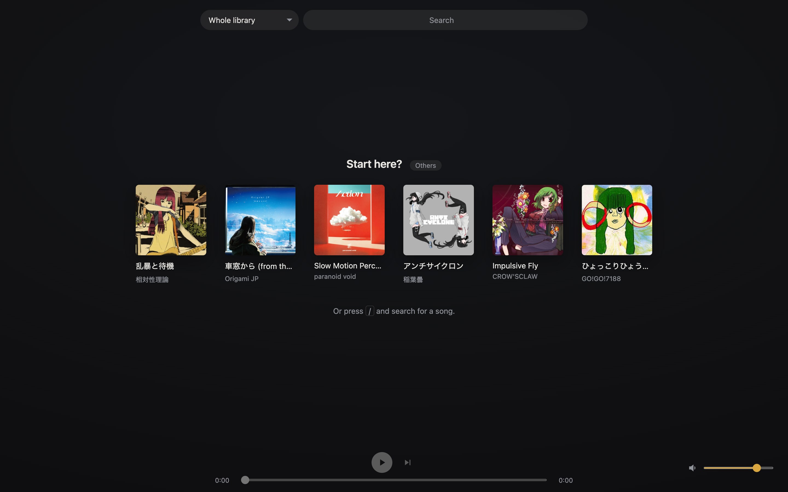
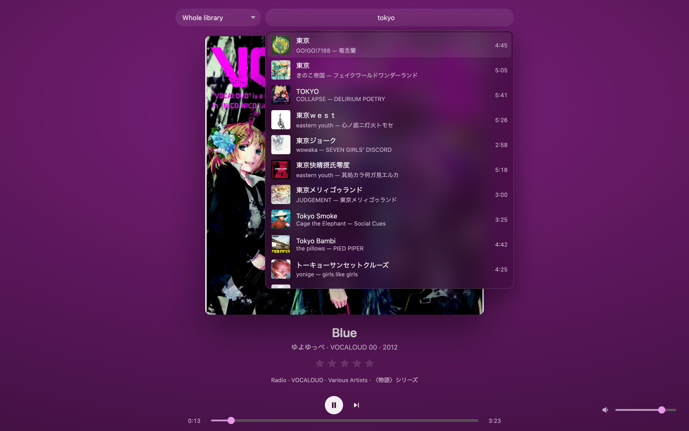
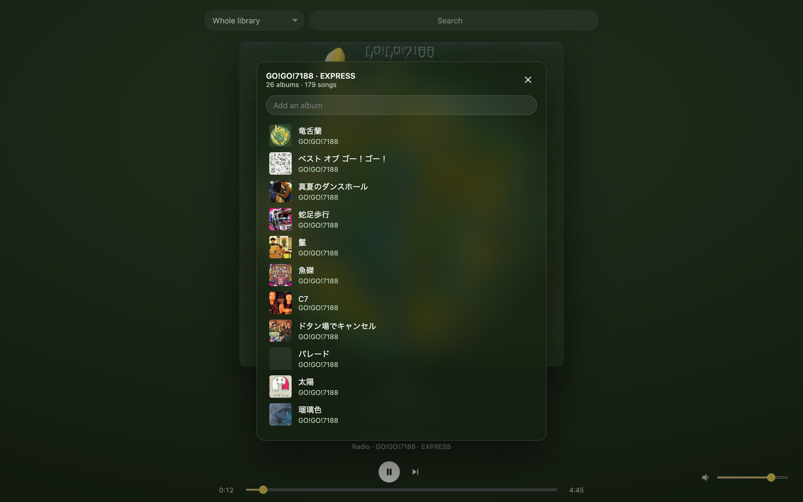

# Heterodina

**Your Plex music library as an endless DJ set, in the original quality.**

Pick one song, or one of a few suggested starting points, and Heterodina keeps the music going. Every next track is chosen to fit what is playing, and it is mixed in as a DJ would. There are no settings, no queue to manage and no playlists to build.

**Why it exists.** Plexamp doesn't run in a browser, and Plex's own shuffle and radio feel like a dice roll. Spotify gets the experience right: you press play once and it keeps going, every song flowing into the next. But it doesn't have your library, your FLACs or your stars. Heterodina mixes the two: Spotify's endless, DJ-mixed listening on top of your own Plex library.

**Why the name.** A heterodyne mixes two signals, and out comes a third frequency that neither of them had on its own. Heterodina does the same: Plex and Spotify go in, and something else comes out.

[](docs/screenshots/playing.jpg)

| Varied starting points | Search in romaji | The radio's universe: click the line under the stars (or press `U`) to see which albums it draws from, and remove or add some |
|---|---|---|
| [](docs/screenshots/start.jpg) | [](docs/screenshots/search.jpg) | [](docs/screenshots/universe.jpg) |

## Why Heterodina

- **It knows what your music belongs to.** Start from a game soundtrack and you get that soundtrack, its composers, the jazz and rock arrangements of it, and the albums around it, not "other music that sounds vaguely similar". It works this out from your own Plex metadata. You can see it (under the stars, next to the file format) and correct it in two clicks.
- **Transitions that sound DJ-mixed, not faded, and fully automatic.**
  - When tempos are within 20%, both songs are time-stretched (pitch kept) onto one tempo that glides from one to the other, so beats and bars stay locked for up to 16 bars.
  - It picks where and how to mix together: for every pair of bar lines near the end of one song and the start of the next, it plays each mixing style through a beat-by-beat simulation and avoids what a dance floor would hate: two bass lines at once, beats with no bass, two voices over each other, clashing chords, level jumps. Mixes land on phrase lines, outros play under intros, and drops get the new bass.
  - It mixes like a club DJ: the new song comes in with its bass killed and mids down, the bass lines swap right before a downbeat, and the old fader comes down last. Sometimes it teases the new song in on the last beat of every other bar, or builds into a drop with a noise riser or a loop roll. Classic beat mixes, bass bombs, echo storms and flanger sweeps are in the pool too.
  - When the keys clash, the new song starts shifted into the old key and glides back to its own pitch.
  - Songs without a steady beat get a long, gentle crossfade at their own speed; tempos too far apart get an echo, spinback or turntable-brake exit.
  - Consecutive album tracks stay gapless, and every track is loudness-normalized.
- **Original quality, no transcoding.** Your files reach the browser as they are, so FLAC stays lossless at its own bit depth: no re-encoding to a streaming bitrate and no Plex transcoder in the playback path. The player shows what each file is, such as `FLAC 24/96` or `MP3 320 kbps`. The only processing is the loudness gain and, during a hand-over, the few bars being mixed.
- **The next song fits the last one.**
  - The radio follows the mood of what just played, so a station drifts naturally instead of jumping around.
  - It avoids slamming a loud ending into a quiet intro.
  - It prefers hand-overs whose tempos can lock.
- **It plays what you love.** Your 3–5★ songs come up more often, and 1★ songs never play. Ratings sync with Plex.
- **Plex sees what you play.** Heterodina shows up in Plex's Now Playing, and plays count in your history and play counts. A song mixed out in its last quarter counts as played; a skipped one doesn't.
- **Variety without effort.** It doesn't repeat songs (or other copies of them), doesn't stack the same album or artist, and doesn't play five arrangements of the same theme in a row.
- **Use your Plex playlists as a filter.** Choose a playlist, smart ones included, and search and radio stay inside it. Let Plex do "unplayed", "no skips" or "4★ and up", and Heterodina does the rest.
- **Search the way you type.** Romaji finds kana and kanji (`tokyo` finds 東京).
- **A calm, focused player.** It shows a big cover, and the colours follow the artwork with smooth transitions. Media keys work, and the UI speaks English, Spanish or Japanese, following your browser.
- **Private by design.** It runs on your machine next to Plex, and the Plex token never reaches the browser.

## How it works, in one minute

1. **Universe.** From the seed album, Heterodina finds related albums. Its evidence is:
   - shared track titles, which link soundtracks to their arrangements;
   - performers, album artists and labels;
   - rare words in album titles (Japanese segmented with kuromoji).

   Small universes widen to the label and then to the genre.
2. **Pick.**
   - Candidates are scored by sonic closeness to the current track (Plex's sonic analysis), universe membership and your stars, with a pinch of exploration.
   - The best few are re-ranked by how well their start follows the current ending, in loudness and in tempo.
   - One is drawn at random among the best, so it is never the obvious choice every time.
3. **Mix.**
   - The browser decodes both tracks and analyses them beat by beat: tempo, bars, key, timbre, harmony, bass, vocals and leads, sections and drops.
   - It simulates every style on every candidate pair of bar lines, picks the points, length and style together, renders the transition offline (time-stretch, key shift, EQ, filters, effects) and splices it sample-exactly between the two songs. [The details.](docs/transitions.md)

## Getting started

```bash
cp .env.example .env   # fill in PLEX_URL and PLEX_TOKEN
docker compose up -d   # http://localhost:5174
```

Running from source, settings, caches and first-start behaviour: [docs/getting-started.md](docs/getting-started.md).

## Usage

Before anything plays, the page suggests six starting points that are as different from each other as the source allows: different universes, artists, labels and genres, with starred songs favoured. Ask for others as often as you like.

The interface follows the browser's language: English, Spanish or Japanese, with English as the fallback.

| Key | Action |
|---|---|
| — | The selector next to the search box picks the source: the whole library or one Plex playlist |
| `/` | Search (original script or romaji) |
| `↵` | Start a radio from the selected track |
| `Space` | Play / pause |
| `N` | Next (short fade) |
| `←` `→` | ±10 s |
| `↑` `↓` | Volume |
| `1`–`5`, `0` | Star rating in Plex (`0` clears it) |
| `U` | Show and correct the radio's universe (or click the line under the stars) |

System media keys work too.

## Documentation

- [Getting started](docs/getting-started.md): Docker, running from source, settings, development commands.
- [Architecture](docs/architecture.md): server and browser, endpoints, search, universe, radio, tempo analysis, Plex API notes.
- [How transitions work](docs/transitions.md): beat grids, beat features, compatibility, cue search, styles, time-stretch, offline render and splice, step by step.

## License

[PolyForm Noncommercial 1.0.0](LICENSE.md): free to use, change and share for any noncommercial purpose (personal use, study, research, hobby projects, charities, schools). Commercial use is not allowed.
